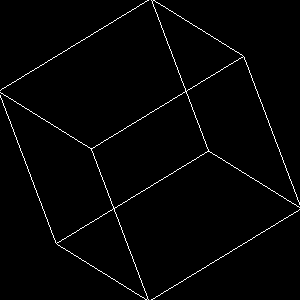
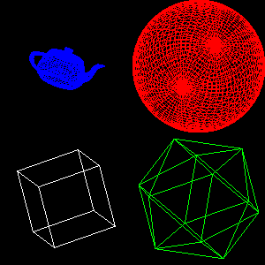
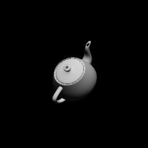
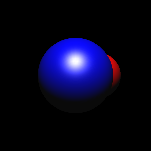
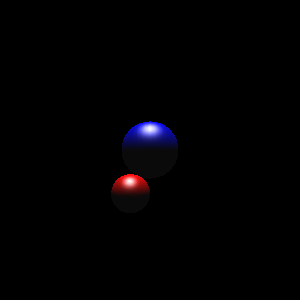
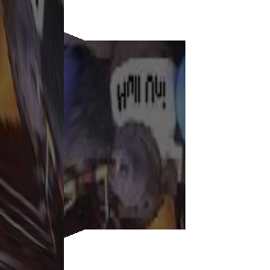
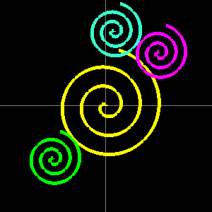
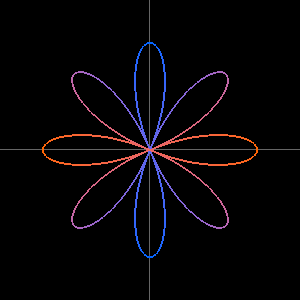
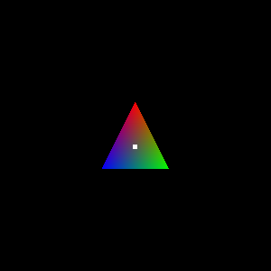

# OpenGL Exercises

A collection of early OpenGL coursework (module *08235 Computer Graphics and
UID*, ~2003–2004), brought back to life. The original programs were written in
Java against the now-defunct **GL4Java** binding and run as applets; this repo
ports them to **C# on [OpenTK](https://opentk.net) 4.x / .NET 8** so they build
and run on a modern machine with a single command.

The rendering is still classic **fixed-function, immediate-mode** OpenGL — the
goal was to preserve the teaching code exactly while replacing only the dead
plumbing (windowing, GLUT/GLU helpers, texture loading). For the full story of
what changed between the bindings — and the default-state gotchas (context
profile, lighting, back-buffer alpha) — see
**[docs/legacy-gl-to-opentk.md](docs/legacy-gl-to-opentk.md)**.

| | | |
| :---: | :---: | :---: |
|  |  |  |
| Ex 1 — GLUT wire cube | Ex 5 — viewports & objects | Ex 7.3 — solid lit teapot |
|  |  |  |
| Ex 8 — specular spheres | Ex 11 — perspective + camera | Ex 13 — texture mapping |
|  |  |  |
| Spiral sketch | Rose / petal curve | Interactive RGB triangle |

## Running

Requires the [.NET 8 SDK](https://dotnet.microsoft.com/download) (or newer) on a
machine with an OpenGL-capable GPU.

```bash
cd src/OpenGLExercises

dotnet run                 # interactive menu of every exercise
dotnet run -- ex7_3        # run one exercise by id
dotnet run -- --list       # list every id
dotnet run -- spiral       # run a 2D sketch
```

Each exercise opens its own window and animates continuously. Close the window
to return.

### Headless capture / verification

Any exercise can be rendered to a PNG without interaction — used to verify the
ports render correctly (and to produce the screenshots above):

```bash
dotnet run -- ex8 --capture out.png --frames 30
```

## Exercises

### OpenGL course (Ex 1–13)

A progression from a first wireframe primitive through lighting, materials,
shading, projection, a camera and texture mapping.

| id | Exercise |
| --- | --- |
| `ex1` | GLUT wire cube in an orthographic view |
| `ex2_1` | GLUT wire teapot |
| `ex2_2` | Cube built by hand from coloured line loops |
| `ex4_1` | The same cube in four quadrant viewports |
| `ex4_2` | Viewports that break the aspect ratio (distortion) |
| `ex5` | Four viewports, four primitives (cube / sphere / icosahedron / teapot) |
| `ex6_1` | First lit, smooth-shaded solid cube |
| `ex6_2` | Lit sphere using the default (grey) material |
| `ex7_1` | Flat-shaded lit sphere |
| `ex7_2` | Smooth-shaded lit sphere |
| `ex7_3` | Solid lit teapot |
| `ex8` | A sphere orbiting another, both with specular highlights |
| `ex9` | As Ex 8 but the light orbits the scene |
| `ex10_1` | Perspective set up directly with `glFrustum` |
| `ex10_2` | Perspective via `gluPerspective` |
| `ex11` | Perspective plus a camera (`gluLookAt`) |
| `ex12_1` | Surface normals — a lit diamond facing the light |
| `ex12_2` | The same diamond with a wrong normal (stays dark) |
| `ex13` | Texture mapping a PNG onto a fan of quads |

### 2D sketches

Small parametric / interactive line drawings.

| id | Sketch | Notes |
| --- | --- | --- |
| `spiral` | Rotating Archimedean spirals | Left/Right arrows reverse the spin |
| `square` | Colour-cycling filled square | |
| `triangle` | Interactive RGB triangle | Space spins it; R/G/B then click moves a vertex |
| `cardioid` | Cardioid `r = a(1 − cos θ)` | reconstructed* |
| `sine` | Sine wave | reconstructed* |
| `petal` | Rose curve `r = cos(4θ)` | reconstructed* |
| `polar` | Limaçon `r = 0.5 + cos θ` | reconstructed* |

\* The original source files for these four were corrupted to binary on disk, so
they are faithful reconstructions from the curves' standard equations, in the
same style as the surviving sketches.

## Project layout

```
src/OpenGLExercises/
  Program.cs            launcher (menu / id / --capture)
  Core/
    ExerciseWindow.cs   GameWindow base — the GLAnimCanvas equivalent + capture
    Glut.cs             cube / sphere / icosahedron (GLUT had no OpenTK port)
    Teapot.cs           Utah teapot from Newell's Bézier patches
    Glu.cs              gluPerspective / gluLookAt
    Texture.cs          PNG -> GL texture (replaces GL4Java's PngTextureLoader)
    Png.cs              dependency-free PNG writer (for --capture)
    Catalog.cs          registry of every exercise
  Exercises/            Ex 1–13
  Exercises/Sketches/   the 2D sketches
docs/
  legacy-gl-to-opentk.md   binding migration + default-state notes
```

## Credits

Original coursework by **Richard Potter**, module *08235 Computer Graphics and
UID*. Ported to C# / OpenTK while preserving the original behaviour.

The teapot control points (`Core/Data/teapotrim.bpt`) are Martin Newell's classic
Utah teapot dataset.
